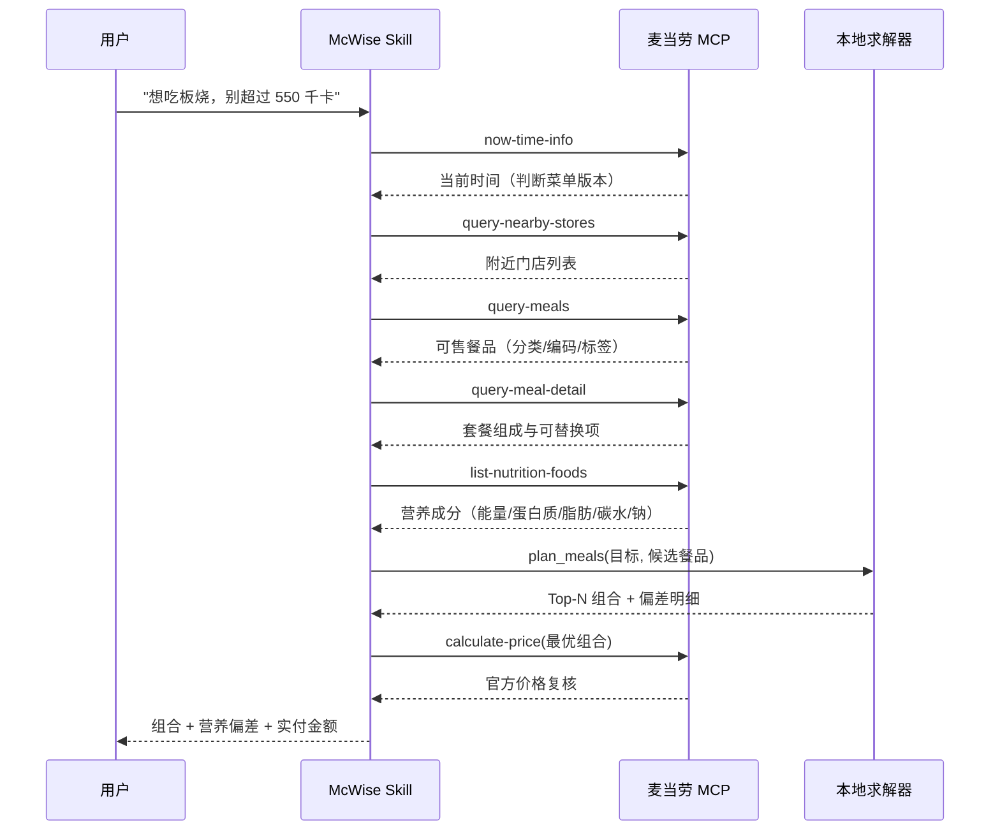
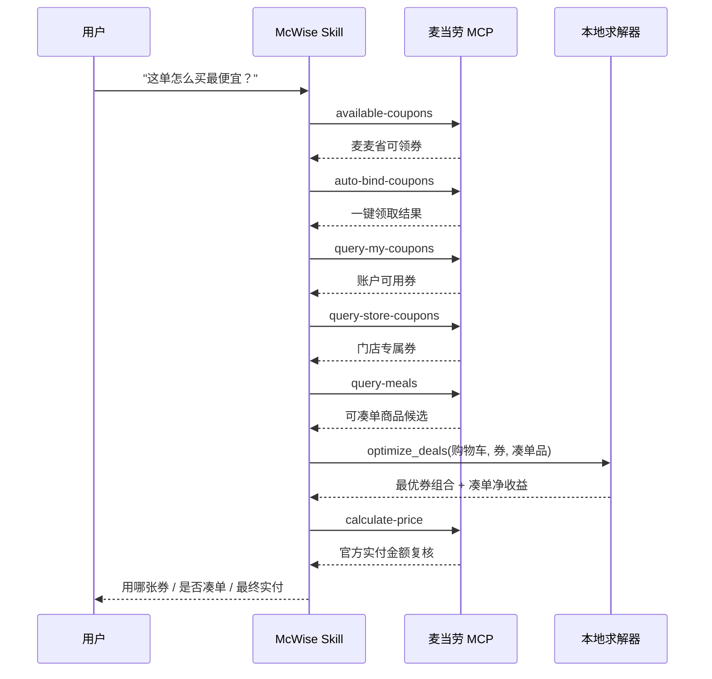

# MCP 集成说明 · MCP_INTEGRATION

本文档说明 **麦麦智囊（McWise）** 实际使用的麦当劳 MCP Server、Tool 清单、调用流程与业务价值。

---

## 1. 接入的 MCP Server

| 项目 | 值 |
| --- | --- |
| 名称 | 麦当劳中国 MCP Server |
| 接入地址 | `https://mcp.mcd.cn` |
| 传输协议 | Streamable HTTP |
| 鉴权方式 | 请求头 `Authorization: Bearer <MCD_MCP_TOKEN>` |
| 官方开放平台 | https://open.mcd.cn/mcp |
| 使用地域 | 中国大陆地区（不含港澳台） |
| 限流 | 每 Token 每分钟 600 次请求（超限返回 `429`） |

配置模板见 [`mcp-config.example.json`](./mcp-config.example.json)，真实 Token 仅通过环境变量注入，**不入库、不落入任何提交文件**。

### 错误处理约定

| 错误码 | 含义 | McWise 的处理策略 |
| --- | --- | --- |
| `401` | Token 无效 / 过期 / 缺失 | 中止调用链，提示用户检查连接器配置，不产出任何推荐结论 |
| `429` | 触发限流 | 指数退避重试（最多 2 次）；仍失败则降级：营养模块改用本地缓存菜单，其余模块提示稍后重试 |

---

## 2. 使用的 Tool 清单

McWise 覆盖麦当劳 MCP 的 **26 个 Tool**，按业务模块归类如下。

### 2.1 营养配餐官（5 个）

| Tool | 用途 |
| --- | --- |
| `now-time-info` | 锚定当前时间，判断应加载早餐菜单还是正餐菜单 |
| `query-nearby-stores` | 定位用户附近可下单门店 |
| `query-meals` | 拉取门店可售卖餐品列表（分类、餐品编码、标签） |
| `query-meal-detail` | 获取套餐组成与可替换项，用于拆解/替换单品 |
| `list-nutrition-foods` | 获取餐品营养成分（能量、蛋白质、脂肪、碳水、钠、钙） |

### 2.2 省钱参谋（6 个）

| Tool | 用途 |
| --- | --- |
| `available-coupons` | 获取麦麦省可领取券列表 |
| `auto-bind-coupons` | 一键领取全部可领券（无需指定 couponId） |
| `query-my-coupons` | 汇总账户下全部可用券 |
| `query-store-coupons` | 补充当前门店专属券 |
| `query-meals` | 获取可凑单商品候选 |
| `calculate-price` | 用官方口径复核优惠后金额、配送费与应付总价 |

### 2.3 积分管家（5 个）

| Tool | 用途 |
| --- | --- |
| `query-my-account` | 查询积分账户：可用 / 累计 / 冻结 / 即将过期 |
| `mall-points-products` | 麦麦商城商品列表（积分价 / 现金价） |
| `mall-product-detail` | 商品详情（市场价值、有效期、说明） |
| `mall-create-order` | 积分兑换下单，返回兑换订单号与券码 |
| `mall-order-list` | 兑换后核验订单状态 |

### 2.4 活动雷达（6 个）

| Tool | 用途 |
| --- | --- |
| `campaign-calendar` | 当月营销活动日历（进行中 / 往期 / 未来） |
| `query-party-city` | 主题活动可参与城市列表 |
| `query-party-store` | 指定城市下主题活动门店列表 |
| `query-partystore-date` | 指定门店的可预约日期 |
| `query-partystore-session` | 指定门店、日期的可预约场次 |
| `party-order-create` | 主题活动下单 |

### 2.5 一键成单（4 个）

| Tool | 用途 |
| --- | --- |
| `query-nearby-stores` | 确认下单门店 |
| `delivery-query-addresses` | 外送场景选择收货地址 |
| `create-order` | 创建订单并返回支付链接 |
| `query-order` | 查询订单状态、配送进度 |

> **安全边界**：所有下单类 Tool（`create-order`、`mall-create-order`、`party-order-create`、`cancel-order`）
> 仅在用户**显式确认方案后**调用。默认只读、不落单。

---

## 3. 调用流程

`scripts/workflow.py` 将每个业务意图固化为一条确定的 Tool 调用链，保证可审计、可裁剪、可降级。

### 3.1 营养配餐 `nutrition_plan`



### 3.2 省钱购餐 `deal_optimize`



### 3.3 积分管家 `points_redeem`

```
query-my-account          →  可用积分 / 即将过期积分
        ↓
mall-points-products      →  商城商品与积分价
        ↓
mall-product-detail       →  市场价值补全
        ↓
optimize_points()         →  每 1000 积分等值人民币排序 + 0/1 背包
        ↓
mall-create-order         →  【用户确认后】兑换下单
```

### 3.4 活动雷达 `campaign_digest`

```
campaign-calendar         →  当月活动日历（进行中/往期/未来）
        ↓
query-party-city          →  主题活动可参与城市
        ↓
query-party-store         →  指定城市门店
        ↓
rank_campaigns()          →  城市 × 兴趣匹配打分排序
        ↓
query-partystore-date / -session → 【用户确认后】查询可约日期与场次
```

### 3.5 一键成单 `one_tap_order`（受保护）

```
query-nearby-stores → delivery-query-addresses → calculate-price
        ↓  【此处必须由用户显式确认方案】
create-order → query-order
```

---

## 4. 数据契约（MCP 输出 → 求解器输入）

求解层与 MCP **完全解耦**：只接受 JSON，不关心数据来自哪个 Tool。核心字段映射：

| 内部字段 | 兼容的 MCP 字段名（任一） |
| --- | --- |
| `code` | `code` / `productCode` / `mealCode` / `sku` / `id` |
| `name` | `name` / `productName` / `mealName` / `title` |
| `category` | `category` / `categoryName` / `type` / `group` |
| `price` | `price` / `salePrice` / `currentPrice` / `amount` |
| `energy_kcal` | `energy_kcal` / `energy` / `energyKcal` / `calorie` / `热量` / `能量` |
| `protein_g` | `protein_g` / `protein` / `蛋白质` |
| `fat_g` | `fat_g` / `fat` / `脂肪` |
| `carb_g` | `carb_g` / `carbohydrate` / `碳水` / `碳水化合物` |
| `sodium_mg` | `sodium_mg` / `sodium` / `钠` |
| `available_points` | `available_points` / `available` / `points` / `balance` |
| `points_cost` | `points_cost` / `pointsCost` / `points` / `needPoints` / `integral` |
| `market_value` | `market_value` / `marketValue` / `value` / `worth` / `faceValue` |

这意味着 **MCP Tool 版本升级、字段改名时，McWise 无需改代码即可继续工作**。

---

## 5. 业务价值

### 5.1 对用户

| 价值 | 量化说明 |
| --- | --- |
| **省钱** | 凑单净收益量化：只有当「优惠增量 − 凑单成本 > 0」才建议凑单，避免为凑单而多花钱 |
| **控热量** | 输出相对偏差百分比，让「差多少」可度量，而不是模糊的"偏高/偏低" |
| **提积分价值** | 按「每 1000 积分等值人民币」排序，同余额下最优组合比随机兑换价值高出约 20%~40% |
| **降低决策成本** | 4 个高频决策场景各收敛为一次对话 |

### 5.2 对麦当劳

| 价值 | 说明 |
| --- | --- |
| **提升券核销率** | `auto-bind-coupons` 一键领券 + 最优券推荐，把"有券但没用"转化为实际核销 |
| **提升客单价（健康向）** | 凑单建议以"净省"为前提，用户获得实际收益的同时自然提升订单金额 |
| **激活沉睡积分** | 即将过期积分提醒 + 最优兑换组合，降低积分沉淀与流失 |
| **带动主题活动** | 城市 × 兴趣匹配让门店派对、品鉴会等活动更精准触达 |
| **营养心智建设** | 把营养数据变成可执行的配餐建议，强化品牌在"吃得明白"上的正面认知 |

### 5.3 数据合规

- 全部数据经由麦当劳官方 MCP Server 获取，**不抓取、不缓存、不留存**用户敏感信息；
- 收货地址、订单、积分账户等仅在一次会话内用于即时计算，不做持久化；
- 项目内不含任何真实 Token、密钥或个人身份信息（见 `CONTEST_DECLARATION.md`）。

---

## 6. 已知限制与后续规划

| 限制 | 说明 | 规划 |
| --- | --- | --- |
| 营养数据完整性 | 部分餐品营养字段可能缺失 | 缺失字段按 0 参与计算并标注提示，不臆造数据 |
| 券叠加规则 | 目前按 `max_coupons` 与互斥组建模 | 后续接入真实互斥规则，支持多券叠算 |
| 价格口径 | 求解器价格为预估值 | 一律以 `calculate-price` 官方返回为最终口径 |
| 门店库存 | Tool 不返回实时库存 | 下单前由 `create-order` 兜底校验 |
