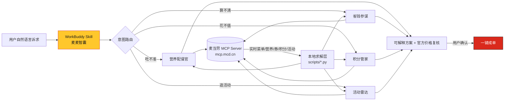

# 麦麦智囊 · McWise

> 让每一次「我想吃麦当劳」都变成一次有据可依的最优决策。

[](./LICENSE)
[](https://www.python.org/)
[](https://open.mcd.cn/mcp)
[](./tests)

**麦麦智囊（McWise）** 是一个基于**麦当劳中国 MCP Server** 构建的智能决策 Skill。
它不做「再包一层聊天框」这种事，而是把麦当劳点餐场景中真正需要算的部分——
**营养配平、优惠券组合、积分价值、活动匹配**——抽象成四个可复用的求解器，
再通过 MCP 拿到的实时数据驱动它们输出可解释、可复核的最优方案。

---

## 1. 项目介绍

### 1.1 我们要解决什么问题

麦当劳 MCP 已经开放了菜单、营养、优惠券、积分商城、活动日历等能力，但**能力 ≠ 决策**。
真实用户面对的是四个反复出现的决策难题：

| 痛点 | 典型内心戏 | McWise 的答案 |
| --- | --- | --- |
| **吃不准** | 「想吃板烧，但又怕今天热量超了」 | 多目标营养配平，给出偏差 < 5% 的组合 |
| **算不清** | 「满 59 减 20 和满 39 减 8，到底该用哪张？要不要凑单？」 | 券组合枚举 + 凑单净收益量化 |
| **花不值** | 「3200 积分换马克杯还是换券？哪个更划算？」 | 每 1000 积分等值人民币排序 + 0/1 背包 |
| **错过活动** | 「有什么活动？我这个城市能参加吗？」 | 城市 × 兴趣的活动匹配排序 |

### 1.2 核心创意

> **把"点麦当劳"建模成一个多目标优化问题，而不是一次关键词检索。**

大多数同类项目停留在「用户问什么、我调什么 Tool」的检索层。McWise 的差异在于：
它在 MCP 之上叠加了一个**求解层**——MCP 负责提供实时事实（菜单、价格、券、积分），
本地求解器负责在约束下搜索最优解，并**把每一步推导过程摊开给用户看**。

三条设计原则：

1. **可解释** —— 每个推荐都附偏差百分比 / 净收益金额 / 匹配理由，不做黑盒结论。
2. **可复核** —— 任何价格结论都要经过官方 `calculate-price` 二次确认才呈现给用户。
3. **可降级** —— 数据缺失、约束过紧、某一 Tool 报错时，优雅退化而不是整链失败。

### 1.3 功能模块

| 模块 | 职责 | 依赖的麦当劳 MCP Tool |
| --- | --- | --- |
| 🥗 **营养配餐官** | 按热量/蛋白质/脂肪/碳水/钠目标求解最优餐品组合 | `list-nutrition-foods`、`query-meals`、`query-meal-detail`、`calculate-price` |
| 💰 **省钱参谋** | 券组合最优解 + 凑单净收益量化 | `available-coupons`、`auto-bind-coupons`、`query-my-coupons`、`query-store-coupons`、`calculate-price` |
| 🎯 **积分管家** | 积分使用效率排序 + 预算内最优兑换组合 | `query-my-account`、`mall-points-products`、`mall-product-detail`、`mall-create-order` |
| 📅 **活动雷达** | 城市 × 兴趣的活动匹配与推荐 | `campaign-calendar`、`query-party-city`、`query-party-store`、`query-partystore-date` |
| 🚀 **一键成单** | 串起上述方案并落单（**需用户显式确认**） | `query-nearby-stores`、`delivery-query-addresses`、`create-order`、`query-order` |

> 完整 Tool 清单、调用顺序与业务价值，见 [`MCP_INTEGRATION.md`](./MCP_INTEGRATION.md)。

---

## 2. 目标用户

| 人群 | 场景 | 为什么需要 McWise |
| --- | --- | --- |
| **健身 / 减脂人群** | 想吃不违反当日宏量目标的一餐 | 需要的是「热量 540 kcal、蛋白质 28 g」级别的精确配平，而不是「这个热量有点高」 |
| **学生党 / 价格敏感白领** | 预算固定，希望每单实付最低 | 券面规则复杂，人工很难算出最优组合与凑单临界点 |
| **积分囤积者** | 积分几千上万，不知道换什么最值 | 不同商品的「每积分价值」差异可达 1.5 倍以上 |
| **家庭 / 亲子用户** | 想参加门店派对、主题活动 | 活动分散在城市/门店/场次三层，检索成本高 |
| **企业团餐负责人** | 需要为团队配餐并控成本 | 可复用同一套配餐 + 省钱求解器（团餐场景已由 MCP 覆盖） |

---

## 3. 架构与数据流



**分层说明**

- **接入层**：WorkBuddy 通过连接器接入麦当劳 MCP（Streamable HTTP + Bearer Token）。
- **编排层**：`scripts/workflow.py` 把业务意图翻译为确定的 Tool 调用链，可审计、可裁剪。
- **求解层**：四个纯 Python 求解器，只吃 JSON、只吐 JSON，**与 MCP 完全解耦**，因此可离线单测。
- **呈现层**：人类可读摘要或完整 JSON，交由 WorkBuddy 组织为最终回复。

---

## 4. 安装方法

### 前提条件

- Python **3.9+**（仅使用标准库，无第三方依赖）
- 一个麦当劳中国 MCP Token（申请方式见 [官方指南](https://github.com/M-China/mcd-mcp-server)）

### 4.1 获取代码

```bash
git clone https://github.com/<your-account>/mcwise.git
cd mcwise
```

### 4.2 配置 MCP 连接

1. 复制脱敏配置模板：

   ```bash
   cp mcp-config.example.json mcp-config.json
   ```

2. 设置环境变量（**不要把真实 Token 写进任何文件**）：

   ```bash
   # macOS / Linux
   export MCD_MCP_TOKEN="你的真实 Token"

   # Windows PowerShell
   $env:MCD_MCP_TOKEN = "你的真实 Token"
   ```

3. 在 WorkBuddy 中接入：左侧边栏【专家·技能·连接器】→【连接器】→ 右上角【自定义连接器】→【配置 MCP】，
   粘贴 `mcp-config.example.json` 的内容并把 `${MCD_MCP_TOKEN}` 替换为实际 Token，保存后启用。

### 4.3 验证安装

```bash
python -m unittest discover -s tests -v
```

预期输出：`Ran 22 tests ... OK`

---

## 5. 使用示例

### 5.1 在 WorkBuddy 中直接对话

```
我中午想吃麦当劳，今天目标是 540 千卡、蛋白质 28 克左右，最好别太油。
帮我搭配一套，并告诉我能不能用券、实付多少。
```

Skill 会自动走 `nutrition_plan` → `deal_optimize` 两条链，输出类似：

```
推荐组合：板烧鸡腿堡 + 玉米杯 + 美式咖啡（中）
热量 535 kcal（-0.9%）| 蛋白质 27 g（-3.6%）| 脂肪 18 g（+0.0%）| 钠 905 mg（+0.6%）
原价 ¥45.00 → 使用「满39减8」→ 实付 ¥46.00（含配送费 ¥9.00）
```

### 5.2 命令行独立运行（无需 MCP，用于调试求解器）

```bash
# 营养配餐优化
python scripts/cli.py nutrition --input examples/nutrition_input.json

# 优惠券与凑单优化
python scripts/cli.py deals --input examples/deals_input.json

# 积分兑换优化
python scripts/cli.py points --input examples/points_input.json

# 活动推荐排序
python scripts/cli.py campaigns --input examples/campaigns_input.json

# 查看某意图的 MCP Tool 调用链
python scripts/cli.py chain nutrition_plan

# 输出完整 JSON（便于程序间传递）
python scripts/cli.py nutrition --input examples/nutrition_input.json --json
```

**实际输出（节选自 `examples/`）**

```
$ python scripts/cli.py deals --input examples/deals_input.json
小计 ¥57.00 → 实付 ¥58.00（省 ¥8.00）
  使用「满39减8」，小计 ¥57.00 减 ¥8.00，另加配送费 ¥9.00，实付 ¥58.00。
  ↘ 凑单建议：加「苹果片」¥8.00，净省 ¥4.00

$ python scripts/cli.py points --input examples/points_input.json
可用积分 3200 → 建议消耗 3100，剩余 100
兑换后总价值约 ¥71.00（效率 ¥22.90/1000 积分）
  · 中杯可乐兑换券：300 积分 ≈ ¥9.00
  · 麦咖啡中杯兑换券：500 积分 ≈ ¥15.00
  · 香芋派兑换券：400 积分 ≈ ¥9.00
  · 麦乐鸡（4块）兑换券：700 积分 ≈ ¥12.50
  · 巨无霸兑换券：1200 积分 ≈ ¥25.50
  ⚠ 有 500 积分即将过期，建议优先消耗。
```

### 5.3 作为 Python 库调用

```python
import sys; sys.path.insert(0, "scripts")
from nutrition_planner import plan_meals

result = plan_meals({
    "target": {"energy_kcal": 540, "protein_g": 28},
    "structure": {"main": 1, "side": 1, "drink": 1},
    "candidates": mcd_mcp_response["items"],  # 直接喂 MCP 的原始返回
}, top_n=3)

for plan in result["plans"]:
    print(plan["total_price"], plan["deviation_pct"])
```

> 求解器对字段命名做了**宽松解析**：MCP 返回的 `energy` / `energyKcal` / `热量` 都能被正确识别。

### 5.4 可视化演示

用浏览器直接打开 [`assets/demo.html`](./assets/demo.html)，无需任何依赖，
即可看到四大模块在同一屏上的方案卡片与量化依据。

---

## 6. 目录结构

```
mcwise/
├── README.md                     # 本文件：项目介绍、安装、使用、目标用户
├── CONTEST_DECLARATION.md        # 参赛声明（官方原文，未做任何改动）
├── MCP_INTEGRATION.md            # MCP Server / Tool / 调用流程 / 业务价值
├── mcp-config.example.json       # 脱敏 MCP 配置（仅环境变量占位符）
├── workbuddy.md                  # WorkBuddy 开发对话上下文
├── SKILL.md                      # 给 WorkBuddy 加载的 Skill 定义
├── LICENSE                       # MIT
├── scripts/
│   ├── mcd_core.py               # 数据模型 + MCP 返回值归一化
│   ├── nutrition_planner.py      # 营养配餐求解器
│   ├── deal_strategist.py        # 券组合 / 凑单求解器
│   ├── points_concierge.py       # 积分价值 + 0/1 背包
│   ├── campaign_radar.py         # 活动匹配排序
│   ├── workflow.py               # 意图 → MCP Tool 调用链
│   └── cli.py                    # 命令行入口
├── tests/
│   └── test_mcwise.py            # 22 个单元测试
├── examples/                     # 输入样例与真实输出快照
├── assets/
│   └── demo.html                 # 单文件方案演示页（浏览器直接打开）
└── references/                   # 营养目标参考、Tool 速查表
```

---

## 7. 赛事相关文件说明

按[麦当劳程序员创意开发大赛活动规则](https://github.com/M-China/mcd-developer-innovation-challenge)要求：

| 文件 | 是否必须 | 说明 |
| --- | --- | --- |
| `README.md` | ✅ 必须 | 项目介绍、安装方法、使用示例、目标用户 |
| `CONTEST_DECLARATION.md` | ✅ 必须且**内容不可改动** | 直接使用官方原文 |
| `MCP_INTEGRATION.md` | ✅ 必须 | 实际使用的 MCP Server / Tool / 调用流程 / 业务价值 |
| `mcp-config.example.json` | ✅ 必须 | 脱敏配置，仅环境变量占位符 |
| `workbuddy.md` | ⭕ 参与 WorkBuddy 专项奖励时提交 | 开发对话上下文 |
| 源代码 | ✅ 必须 | `scripts/`、`tests/` |

---

## 8. 免责声明

- 本项目为**麦当劳程序员节创意开发大赛参赛作品**，由参赛者独立开发，**非麦当劳官方产品**。
- 项目输出仅供参考，**不构成医疗、营养或其他专业建议**；餐品信息、价格及供应状态**以麦当劳官方渠道的实时结果为准**。
- `examples/` 与 `references/` 中的营养、价格、券面、积分数据为**教学示例**，正式使用请以 MCP 实时返回为准。
- 本项目不含任何真实 Token、密钥或他人个人信息。

---

## 9. License

[MIT](./LICENSE) © 2026 McWise Contributors
